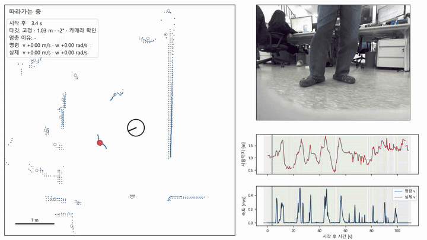
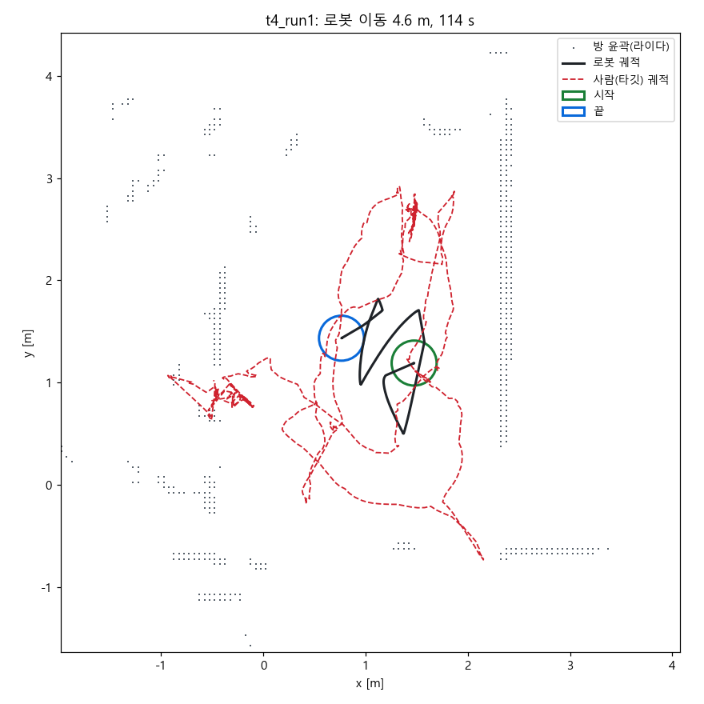

# kebi_follow_me

카메라(YOLO, RK3588 NPU) + 2D 라이다로 사람 다리를 보고 따라가는 follow-me.



실차 T4 1단계 (선속도 상한 0.5 m/s, 2배속, [MP4](docs/media/t4_follow_demo.mp4)).
- 왼쪽: 위에서 본 지도. 파란 점은 현재 라이다, 회색 원은 다리 트랙, 빨간 점과 점선은 따라가는 사람이다. 검은 원은 로봇이다.
- 오른쪽 위: 로봇 카메라. 시간을 맞췄고 얼굴은 모자이크했다.
- 오른쪽 아래: 사람까지 거리, 명령 속도와 실제 속도. 배경색은 상태다(초록 추종, 빨강 일시 정지).

| 패키지 | 내용 |
|---|---|
| kebi_follow_msgs | 내부 메시지 |
| kebi_follow_detector | `cam_leg_detector` 카메라 다리 검출 |
| kebi_follow_tracker | `leg_tracker` 라이다 다리 추적, 타깃 관리 |
| kebi_follow_controller | `follow_controller` 상태기계, 추종 제어, 안전 게이트 |
| kebi_follow_me | launch, 파라미터, 문서 |

```bash
colcon build --packages-up-to kebi_follow_me
ros2 launch kebi_follow_me follow_me.launch.py            # shadow:=true 면 /cmd_vel 대신 그림자 토픽
ros2 topic pub --once /follow/ui/client follow_msgs/msg/UiClient "{cmd: 1}"   # START (3 = STOP)
```

## 실차 시험 (2026-11-12)

| 단계 | 내용 | 결과 |
|---|---|---|
| T1 그림자 | 도킹 상태, 명령만 기록 | 1.1 s 만에 고정, 118 s 동안 같은 ID |
| T2 회전 | 선속도 0, 회전 0.3 rad/s | 사람 쪽으로 회전, 상한 지킴 |
| T3 저속 | 0.2 m/s | 4 m 이동, 추종 거리 중앙값 1.06 m, 명령→실제 지연 약 0.1 s |
| T4 1단계 | 0.5 m/s, 편안함 기준 값 | 위 영상. 실제 0.5 m/s 도달 |



사양: [docs/SPEC.md](docs/SPEC.md)
